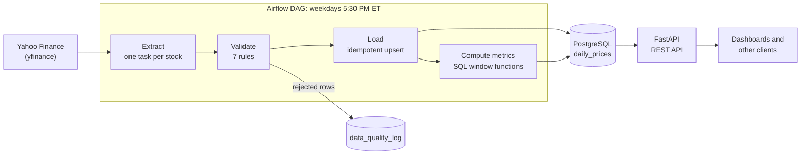

# Market Data Pipeline


An end-to-end data engineering project: an **Apache Airflow** pipeline that downloads daily stock prices for 20 US equities, validates every row, loads them idempotently into **PostgreSQL**, computes trading metrics with **SQL window functions**, and serves everything through a **FastAPI** REST API. The whole stack starts with one command: `docker compose up`.

## Highlights

- **Orchestrated with Airflow 3:** runs every weekday at 5:30 PM ET, after the market closes, with one dynamically mapped task per stock and automatic retries.
- **Idempotent loads:** a composite primary key plus `INSERT ... ON CONFLICT DO UPDATE` means re-running the pipeline never creates duplicates.
- **Data quality first:** 7 validation rules in Python plus `CHECK` constraints in the database. Rejected rows are logged with the original data, never silently dropped.
- **Full audit trail:** every run is recorded with its status, row counts, and any failed tickers.
- **Trading metrics in SQL:** daily returns, 20-day moving averages, and 20-day volatility computed with window functions inside the database.
- **REST API:** 5 endpoints with input validation, correct HTTP status codes, and auto-generated interactive docs.
- **Tested:** 21 pytest tests, run automatically on every push by GitHub Actions.
- **One-command setup:** Docker Compose starts PostgreSQL, Airflow, and the API. The schema is created automatically on first start.

## Architecture



## Tech stack

| Area | Tools |
|---|---|
| Language | Python 3.12, SQL |
| Orchestration | Apache Airflow 3 (TaskFlow API, dynamic task mapping) |
| Database | PostgreSQL 16 |
| API | FastAPI, Pydantic, Uvicorn |
| Data processing | pandas, yfinance |
| Infrastructure | Docker, Docker Compose, Linux (WSL2) |
| Testing and CI | pytest, GitHub Actions |

## Quick start

You need [Docker Desktop](https://www.docker.com/products/docker-desktop/) and Git.

```bash
git clone https://github.com/tanishawdh-maker/market-data-pipeline.git
cd market-data-pipeline
cp .env.example .env          # database settings; change the password if you like
docker compose up -d --build
```

Then open:

| Service | URL |
|---|---|
| Airflow dashboard | http://localhost:8080 |
| API docs (interactive) | http://localhost:8000/docs |

**Load a year of history:** in Airflow, turn on `market_data_pipeline`, click **Trigger**, set `period` to `1y`, and run it. About 5,000 rows load in a minute or two.

Stop everything with `docker compose stop`. Your data lives in a Docker volume and survives restarts.

## API

| Endpoint | Returns |
|---|---|
| `GET /health` | Whether the API can reach the database |
| `GET /tickers` | All tracked stocks |
| `GET /prices/{symbol}?start=&end=&limit=` | Daily price bars, newest first |
| `GET /metrics/{symbol}?limit=` | Daily return, 20-day moving average, 20-day volatility |
| `GET /runs?limit=` | Recent pipeline runs and their status |

```bash
curl "http://localhost:8000/prices/AAPL?limit=2"
```
```json
[
  {"trade_date": "2026-10-09", "open": 331.7, "high": 338.61, "low": 330.7, "close": 336.64, "adj_close": 336.64, "volume": 37855000},
  {"trade_date": "2026-10-08", "open": 336.82, "high": 341.57, "low": 335.9, "close": 340.42, "adj_close": 340.42, "volume": 35332400}
]
```

Errors use proper status codes: `404` for an unknown ticker, `400` when `start` is after `end`, and `422` for invalid input such as `limit=0`.

## Database schema

| Table | Purpose |
|---|---|
| `tickers` | The 20 stocks being tracked |
| `daily_prices` | One open/high/low/close/volume bar per stock per trading day |
| `daily_metrics` | Daily return, 20-day moving average, and 20-day volatility, computed from `daily_prices` |
| `pipeline_runs` | One row per pipeline run, for auditing |
| `data_quality_log` | Every rejected record, with the reason and the original data |

Key design choices:

- **Composite primary key `(symbol, trade_date)`** makes duplicate bars impossible and makes every load an upsert.
- **`CHECK` constraints** (positive prices, `high` is the day's highest value, non-negative volume, weekdays only) reject bad data at the database level, as a second line of defense behind the Python validation.
- **`NUMERIC` instead of `FLOAT`** keeps prices exact.
- **Raw and derived data live in separate tables**, so metrics can be recomputed without re-downloading anything.

## Reliability: real issues found and fixed

- **Dividend-only rows:** CME data showed one rejected row. Investigation through `data_quality_log` showed that yfinance appends a row with null prices when a dividend falls just before the requested window. The `missing_values` check blocks it, so it can never overwrite real prices, and a regression test now covers it.
- **Overlapping Airflow runs:** two runs started at the same time, and one falsely reported failures, because each upsert re-stamped rows with its own run ID. The data stayed correct thanks to idempotent loads. The fix: `max_active_runs=1`, and each task now reports its own result instead of inferring it from shared state.
- **Intraday partial bars:** a backfill run during market hours loaded today's still-changing prices. This is why the schedule runs after the close, and the next scheduled run replaces provisional values with final ones through the upsert.

## Testing

```bash
pip install -r requirements.txt -r api/requirements.txt -r requirements-dev.txt
pytest -v
```

The tests cover every validation rule and every API status code. API tests replace the database with a fake, so they run in about a second, with no database needed. GitHub Actions runs the full suite on every push.

## Project structure

```
market-data-pipeline/
├── dags/market_data_dag.py   # Airflow DAG: schedule, retries, dynamic task mapping
├── etl/
│   ├── extract.py            # download prices from Yahoo Finance
│   ├── transform.py          # clean and validate rows
│   ├── load.py               # idempotent upsert, run tracking, rejection logging
│   ├── metrics.py            # returns, moving average, volatility in SQL
│   ├── pipeline.py           # run the full pipeline without Airflow
│   └── db.py                 # database connection (settings from .env)
├── api/                      # FastAPI app and its Dockerfile
├── airflow/Dockerfile        # Airflow image with the pipeline's packages
├── sql/                      # schema, seed data, and schema tests
├── tests/                    # pytest tests for validation and the API
├── .github/workflows/        # GitHub Actions CI
└── docker-compose.yml        # PostgreSQL + Airflow + API
```

## Author

**Tanisha Mukherjee**: [LinkedIn](https://linkedin.com/in/tanisha-mukherjee-760a203b6) · [GitHub](https://github.com/tanishawdh-maker)
